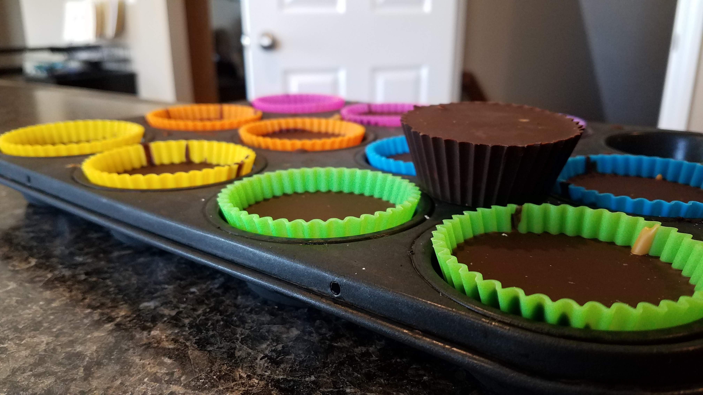

```{r}
#| label: setup-salted-caramel-peanut-butter
#| results: false
#| output: false


library("tidyverse")
library("tinytable")


tlwd <- 0.125
bgcol <- "grey60"
bgcol <- "skyblue4"


```


## Salted Caramel Peanut Butter Cups




These are a dairy-free peanut butter cup, and holy crap are they good.


**Source:** [FlavorTheMoments](https://flavorthemoments.com/salted-dark-chocolate-peanut-butter-cups/)


**Ingredients:**


```{r}
#| label: salted-caramel-peanut-butter

dat <- tibble(
  Ingredients = c(
    "12 ounces chocolate",
    "4 tsp coconut oil",
    "12 tbsp sugar",
    "1 tsp salt",
    "1/2 - 3/4 cup smooth peanut butter"
  ),
  spcr1 = " ",
  Tools = c(
    "Two pots that will nest",
    "Spatula",
    "Spoons + measuring cups",
    "Cupcake pan",
    ""
  )
)


colnames(dat)[str_detect(colnames(dat), "spcr")] <- ""

dat |> 
  tt(  theme = "striped" ) |> 
  style_tt(fontsize = 0.8) |> 
  style_tt( i=0, background=bgcol, color="white")


```


**Directions:**

1. Prepare a double boiler. This means: Put some water in the larger pot and set it to heating/boiling. Put the other pot in it, so that the water heats the inner pot, but it’s not directly touching the burner.
2. Put cupcake wrappers in the tin.
3. Add just over half of the chocolate to the inner pot (I usually use 7 ounces), and approximately half the coconut oil. Let melt (once they start, you can whisk/mix to help it along).
4. Add 1 tbsp of sugar for each ounce of chocolate, and approximately half the salt. Whisk to spread evenly and let it dissolve. It may not fully dissolve, that’s okay.
5. Distribute the melted chocolate across 12 cupcake wrappers. Shake/jiggle the pan to even it out if needed.

- In addition, I suggest tilting the pan in all directions to try and coat the sides of he wrappers with chocolate. Put the pan in the freezer for short amounts to let the edge set, and then do it again. I usually get 2-3 layers built up along the edges.

6. Put the cupcake pan in the freezer to set the bottom.
7. While the pan is in the freezer, start a second batch of chocolate for the top coat.
8. When the first batch (sides and bottom) are ready, put the peanut butter in a microwave-safe cup and heat it (approximately 15-25 seconds to start) so that it will spread and pour more easily.
9. Add peanut butter to each cup. Again shake/Jiggle the pan to settle the peanut butter, you don’t want it to be “mounded”. You may want to put the pan back in the freezer to set the peanut butter.
10. Add the chocolate to the top of the peanut butter. Try to make sure the peanut butter is fully covered by the second layer of chocolate.
11. Put the pan back in the freezer to set the chocolate.
12. Optional: When it is mostly but not fully set, use a salt griner to grind some sea salt / rock salt on the top. If you do this too soon, the flakes will sink into the chocolate, which doesn’t look as fancy.


**Variations:**

- I usually add a touch more salt. Maybe another 1/2 tsp or so.
- I’ve been tinkering with reducing the sugar. But don’t reduce it too much, otherwise these will be much more bitter. My first batch used 4 tbsp (I think for the top and the bottom each) and it was still quite bitter.
- Replacing the sugar with Lakanto monkfruit sugar would probably work perfectly well.

**Notes:**

- I usually don't go overboard on the peanut butter. Too much, and it winds up being annoyingly dry when you bit into it. Like when you give a dog a big glob of peanut butter.
- Keep these in the fridge. They start getting melty easily.
- This recipe is for 12 peanut butter cups. If your cupcake pan isn’t that big, adjust accordingly.
- The chocolate I used was Bakers. Each box is 4 ounces, so I used 3 boxes at a time.
- The tops and bottoms of these peanut butter cups are a bit thick. Personally, I like that. - If you have a second cupcake pan, you may be able to stretch the chocolate and get a few more peanut butter cups out of it.


